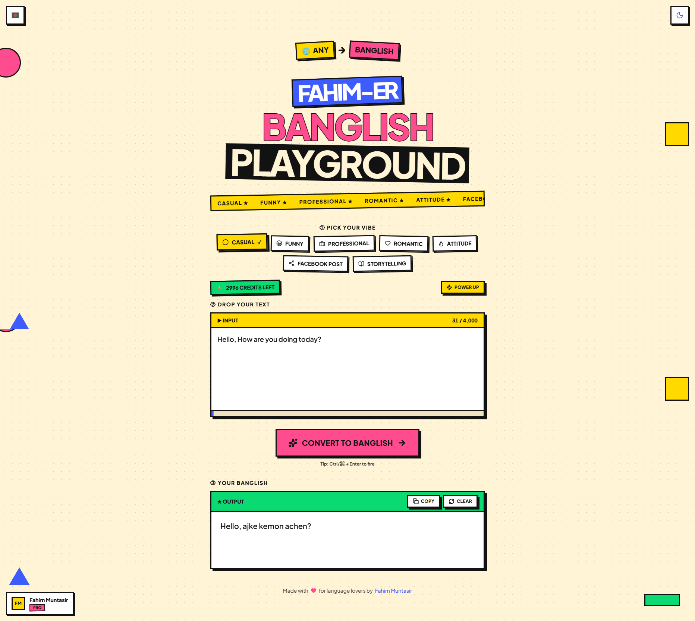

# Banglish Translator

**Translate any language into natural, conversational Banglish.**

This Translator is an AI-powered tool that transforms text into Romanized Bangla (Banglish), designed for everyday conversations, social media posts, and personal communication.

Built with Next.js, TypeScript, Tailwind CSS, Firebase, and Google Gemini AI.

**Live Demo:** [https://banglish-translator.vercel.app](https://banglish-translator.vercel.app)

---

## 📸 Screenshots

### Main Interface



### Dark Mode


### Choose Your Plan


---

## ✨ Features

- **Multi-language input** — Convert text from Bangla, English, Hindi, Chinese, Japanese, Arabic, Russian, German, and more.
- **Conversational Banglish** — Generate natural-sounding Banglish for chats and social media.
- **Multiple writing styles** — Choose a tone that fits your message.
- **Smart transliteration** — Preserve Bangla wording when converting it into Romanized Bangla.
- **Banglish correction** — Improve spelling when the input is already written in Banglish.
- **AI-powered conversion** — Uses Google Gemini (`gemini-2.5-flash`).
- **Google authentication** — Sign in with Firebase Authentication.
- **Server-enforced usage limits** — Apply account-based conversion quotas.
- **Paid plans** — Includes an SSLCommerz checkout flow for plan upgrades.
- **Light and dark themes** — Supports system-aware theme preferences.
- **Keyboard shortcuts** — Press `Ctrl + Enter` or `Cmd + Enter` to convert.
- **Accessibility** — Keyboard navigation, focus states, semantic HTML, and screen-reader support.

---

## 🎭 Writing Styles

Choose a style to match your intended tone and context.

| Style | Best for |
|---|---|
| Casual | Everyday conversations |
| Funny | Playful, humorous messages |
| Professional | Polite, work-friendly communication |
| Romantic | Emotional and affectionate messages |
| Attitude | Bold and confident expressions |
| Facebook Post | Social media content |
| Storytelling | Narrative-style writing |

The conversion prompt combines general conversion rules with style-specific instructions to help preserve meaning, structure, and tone. AI output may still contain errors.

---

## 🧠 How It Works

1. Sign in with your Google account.
2. Select a writing style.
3. Enter text in your preferred language.
4. Submit the text for AI-powered conversion.
5. Copy and use the generated Banglish.

The server verifies the user's identity, checks the applicable usage limits, processes the request through Gemini, and returns the result.

---

## 🔤 Conversion Rules

The conversion logic is designed around the type of input:

- **Bangla:** Prioritizes transliteration over paraphrasing.
- **Already Banglish:** Focuses on correcting spelling without unnecessarily changing sentence structure.
- **English and other languages:** Generates natural, spoken Banglish while aiming to preserve the original meaning.
- **Output:** Avoids explanations and unnecessary rewriting.

These are prompt-driven behaviors, not guarantees of perfect translation or transliteration.

---

## 🎯 Usage & Credits

| Plan | Usage model |
|---|---|
| Free | 2 conversions per day |
| Starter | Monthly conversion quota |
| Pro | Monthly conversion quota |
| Business | Monthly conversion quota |

- Free usage resets according to the server's calendar day.
- Paid usage follows a monthly quota.
- Usage updates are reflected in the interface through Firestore listeners.
- The server is authoritative for usage enforcement.

**Payment note:** Paid-plan checkout currently uses SSLCommerz as a one-time payment flow. Automatic recurring billing and plan-expiration enforcement are not implemented.

---

## 🔐 Authentication & Payment Security

- Google sign-in through Firebase Authentication.
- Server-side Firebase ID-token verification.
- Server-controlled plan pricing.
- SSLCommerz transaction validation before activating a paid plan.
- Checks for transaction ID, validation ID, amount, and currency.
- Idempotent handling of repeated successful payment callbacks.
- Server-side enforcement of privileged plan and usage changes.
- Firestore security rules for user profile access.

Deploy and verify `firestore.rules` against your Firebase project before enabling client-side Firestore access.

---

## 🛠️ Tech Stack

### Frontend

- Next.js
- TypeScript
- Tailwind CSS
- Lucide Icons
- Sonner

### Backend & Services

- Next.js Route Handlers
- Firebase Authentication
- Cloud Firestore
- Firebase Admin SDK
- Google Gemini AI
- SSLCommerz

### Testing

- Jest
- React Testing Library

---

## 🚀 Getting Started

### Prerequisites

- Node.js and npm
- A Firebase project with Authentication and Firestore configured
- A Google Gemini API key
- SSLCommerz credentials if testing the payment flow

### Installation

```bash
git clone https://github.com/fahim-muntasir/Banglish-Translator.git
cd Banglish-Translator
npm install
```